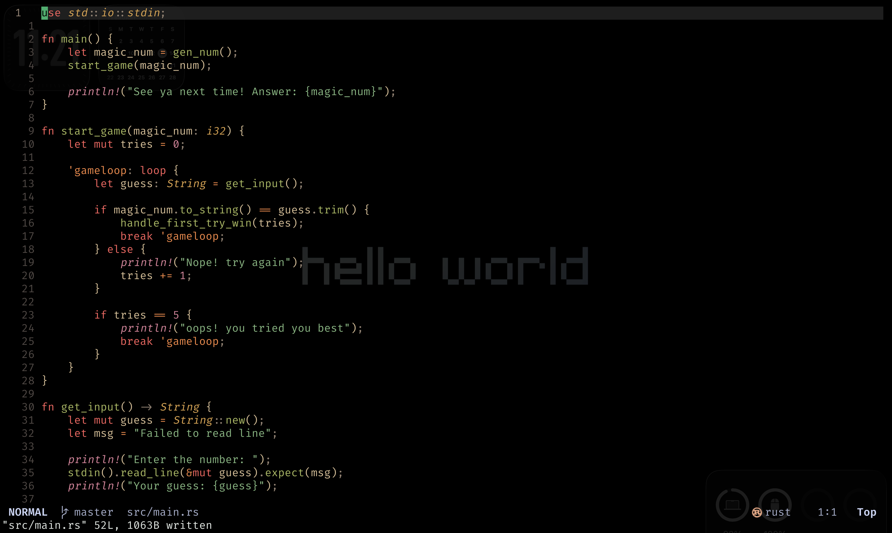

# Neovim Configuration

My Neovim setup in Lua: lazy.nvim, native `vim.lsp` with Mason, conform formatting, Telescope, Harpoon, and the [Hell Pine](https://github.com/abxengg/hell-pine.nvim) colorscheme.



---

## Quick Overview

| Feature | Plugin/Feature |
|---------|---------------|
| Plugin manager | lazy.nvim (bootstraps itself on first start) |
| Theme | [hell-pine.nvim](https://github.com/abxengg/hell-pine.nvim) (transparent background) |
| Completion | blink.cmp + LuaSnip + friendly-snippets |
| LSP | native `vim.lsp.config` / `vim.lsp.enable` + nvim-lspconfig + Mason |
| Java / Kotlin | nvim-java (jdtls), kotlin.nvim (kotlin-lsp) |
| Formatting | conform.nvim (format on save, LSP fallback) |
| Fuzzy finder | Telescope (vertical layout) |
| Git | Fugitive, Diffview, Gitsigns |
| Navigation | Harpoon2, Oil |
| Text objects | mini.ai (+ Treesitter function/class objects) |
| Surround | mini.surround |
| Comments | Comment.nvim, todo-comments |
| Diagnostics | Trouble, tiny-inline-diagnostic |
| UI | Lualine, fidget, dressing |
| Web | nvim-ts-autotag, highlight-colors, document-color, schemastore |

---

## Requirements

- Neovim 0.12 (tested on 0.12.3; uses `vim.lsp.config`, `vim.lsp.enable`, `vim.diagnostic.jump`)
- Git, a C compiler (Treesitter parsers), Node.js (web language servers)
- A Nerd Font
- ripgrep (Telescope live grep)
- A JDK for jdtls / kotlin-lsp (optional, only for JVM work)
- tmux (optional, for the sessionizer key)

## Installation

```bash
# Back up an existing config
mv ~/.config/nvim ~/.config/nvim.bak

# Clone this config
git clone https://github.com/AbiXnash/nvim.git ~/.config/nvim

# Start Neovim: lazy.nvim installs plugins, Mason installs the tools below
nvim
```

This repo is also a submodule of my [dotfiles](https://github.com/AbiXnash/dotfiles), which links it into place.

---

## Layout

```
init.lua                    -> require("abx")
lsp/*.lua                   per-server settings (override nvim-lspconfig's defaults)
lua/abx/init.lua            lazy.nvim bootstrap, loads configs and keymaps
lua/abx/config.lua          a few remappable keys (window nav, centered scroll)
lua/abx/configs/            options, diagnostics + LSP keymaps, inlay hints, Python helpers, Treesitter guard
lua/abx/keymaps/            core, motions, editor, Python, tmux keymaps
lua/abx/plugins/ui/         colorscheme, blink.cmp, lualine, fidget, dressing
lua/abx/plugins/tools/      LSP, Mason, conform, Telescope, Git, Treesitter, Harpoon, Oil, ...
lua/abx/plugins/misc/       web-dev helpers
```

---

## LSP

Servers enabled in `lua/abx/plugins/tools/lsp.lua`:

| Language | Server |
|----------|--------|
| Lua | `lua_ls` |
| Go | `gopls` |
| TypeScript / JavaScript | `vtsls` (with the Svelte TS plugin when available) |
| Svelte | `svelte` |
| Web | `eslint`, `tailwindcss`, `emmet_ls`, `html`, `cssls` |
| Python | `basedpyright` |
| Gradle / Groovy | `gradle_ls`, `groovyls` |
| Java | `jdtls` via nvim-java |
| Kotlin | `kotlin-lsp` via kotlin.nvim |

**Files in `lsp/` win.** nvim-lspconfig's own `lsp/*.lua` files load later on the runtimepath, so on a plain merge they would replace this repo's values. The LSP setup applies every file in `lsp/` explicitly, so its values override lspconfig's defaults. For `on_attach`, `on_init` and `before_init`, both hooks run: lspconfig's first, then the one from `lsp/`.

**lua_ls** gets Neovim API types from lazydev.nvim. LÖVE types (`~/love2d-types/library`) are added only when the project root has a `main.lua` or `conf.lua`.

**Mason** (`mason-tool-installer`) installs only tools this config actually runs: the servers above, the conform formatters, and what nvim-java and kotlin.nvim launch (jdtls, java-test, java-debug-adapter, kotlin-lsp). If you add a linter, add something that runs it too (e.g. nvim-lint).

## Formatting

conform.nvim formats on save (500 ms timeout, LSP fallback). `<leader>tF` turns it off for the current buffer.

| Filetype | Formatter |
|----------|-----------|
| Lua | stylua (4 spaces) |
| Go | gofumpt (unchanged, so Go keeps tabs) |
| JS / TS / React / Svelte | prettierd |
| Python | black |
| sh / bash | shfmt (`-i 4 -ci`) |
| Java | google-java-format (`--aosp`) |
| Kotlin | ktlint |

Indentation is 4 spaces everywhere except Go and Makefiles, which keep tabs.

---

## Keybindings

Leader is `<Space>`.

### General

| Key | Action |
|-----|--------|
| `Esc` | Clear search highlight |
| `jk` / `kj` | Exit insert mode |
| `<C-c>` | Copy to system clipboard (visual) |
| `,` / `.` | Move selection down / up (visual) |
| `<C-h/j/k/l>` | Move between windows |
| `<C-d>` / `<C-u>` | Half-page scroll, centered |
| `<leader>e` | File explorer (Oil) |
| `<leader>g` | Git status (Fugitive) |
| `<leader>U` | Toggle Undotree |
| `<leader>/` | Toggle line comment |
| `<C-f>` | tmux sessionizer (from my dotfiles scripts) |
| `<leader>cf` | Format buffer (conform) |
| `<leader>tF` | Toggle autoformat (buffer) |

### Text objects (mini.ai)

mini.ai's built-in text objects (brackets, quotes, arguments, tags, ...) plus Treesitter ones:

| Key | Object |
|-----|--------|
| `af` / `if` | Function (outer / inner) |
| `ac` / `ic` | Class (outer / inner) |

### LSP & Diagnostics

| Key | Action |
|-----|--------|
| `gd` / `gD` | Definition / declaration |
| `gr` | References (Telescope) |
| `gi` | Implementations (Telescope) |
| `gt` | Type definitions (Telescope) |
| `K` | Hover docs |
| `<leader>ca` | Code actions |
| `<leader>rn` | Rename |
| `<leader>rs` | Restart LSP |
| `<leader>d` | Line diagnostics |
| `<leader>D` | Buffer diagnostics (Telescope) |
| `[d` / `]d` | Previous / next diagnostic |

### Telescope

| Key | Action |
|-----|--------|
| `<leader><leader>` | Find files |
| `<leader>fs` | Live grep |
| `<leader>fg` | Git files |
| `<leader>fb` | Buffers |
| `<leader>fd` | Diagnostics |
| `<leader>fh` | Help tags |
| `<leader>fr` | Recent files |

### Harpoon

| Key | Action |
|-----|--------|
| `<leader>a` | Add file |
| `<C-e>` | Toggle menu |
| `<leader>h/j/k/l/;` | Jump to file 1–5 |
| `<C-p>` / `<C-n>` | Previous / next file |

### Git (Gitsigns)

| Key | Action |
|-----|--------|
| `]c` / `[c` | Next / previous hunk |
| `<leader>ghs` / `<leader>ghr` | Stage / reset hunk |
| `<leader>ghS` / `<leader>ghR` | Stage / reset buffer |
| `<leader>ghu` | Undo stage hunk |
| `<leader>ghp` | Preview hunk |
| `<leader>ghb` | Blame line |
| `<leader>ghd` / `<leader>ghD` | Diff this / against `~` |

### Trouble

| Key | Action |
|-----|--------|
| `<leader>xx` | Diagnostics |
| `<leader>xX` | Buffer diagnostics |
| `<leader>cs` | Symbols |
| `<leader>cl` | LSP definitions / references |
| `<leader>xL` | Location list |
| `<leader>xQ` | Quickfix list |

### Python

These use the project's `.venv` / `venv` / `env`, then `$VIRTUAL_ENV`, then `python3`.

| Key | Action |
|-----|--------|
| `<leader>pr` | Run file |
| `<leader>pt` | pytest current file |
| `<leader>pl` | pytest project |
| `<leader>pn` | pytest test under cursor |
| `<leader>po` | Organize imports |
| `<leader>pu` | Run FastAPI app with `uvicorn --reload` |

### Completion (blink.cmp)

| Key | Action |
|-----|--------|
| `<Tab>` / `<S-Tab>`, `<C-n>` / `<C-p>`, `<C-j>` / `<C-k>` | Next / previous item |
| `<CR>` | Accept |
| `<C-space>` | Show menu |
| `<C-e>` | Hide menu |
| `<C-b>` / `<C-f>` | Scroll docs |
